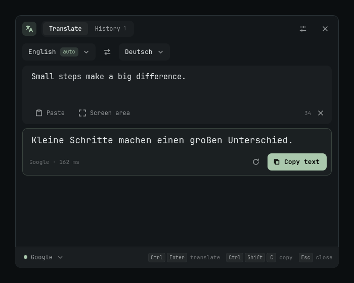
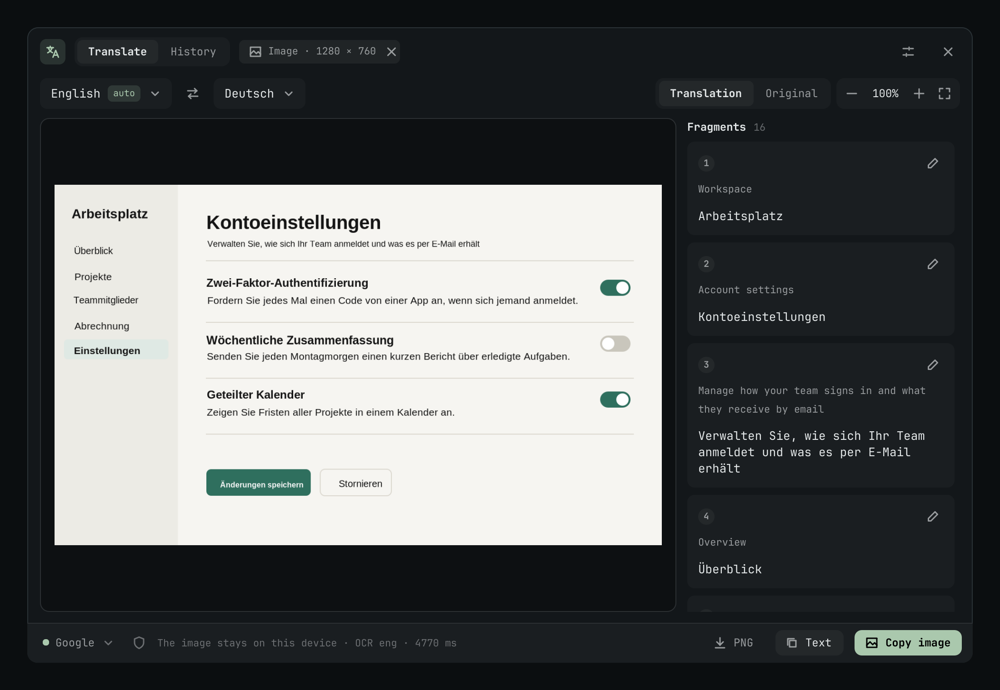
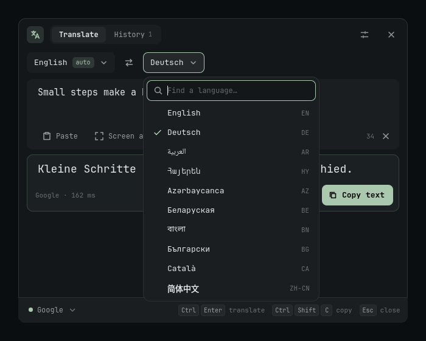

<div align="center">

# OmaTranslate

**Select. Translate. Keep going.**

Instant translation of selected text, the clipboard and screenshots for [Omarchy](https://omarchy.org): a native Rust backend with a QML panel that follows your desktop theme.

[](https://github.com/vornashev/OmaTranslate/actions/workflows/ci.yml)
[](LICENSE)
[](https://omarchy.org)

**English** · [Русский](README.ru.md)



</div>

## Why OmaTranslate

- **One keystroke.** Select text in any app and press <kbd>Super</kbd>+<kbd>U</kbd>. No copy, no browser tab.
- **Translate in place.** <kbd>Super</kbd>+<kbd>Ctrl</kbd>+<kbd>U</kbd> replaces the selection with its translation, right in the app you're typing in.
- **Screenshots, translated on the image.** Pick a screen region. Text is recognized locally with Tesseract and the translation is drawn over the original in matching size and weight, cell by cell and paragraph by paragraph.
- **55 languages, detected offline.** Your two languages (say German and English) are pinned. Text already in your language goes to the other one automatically.
- **Names stay names.** CamelCase, product names and versions (`GPT-6`, `FrontierCode`, "Name 5.2") are not translated. Add your own terms to a do-not-translate list.
- **Private by default.** Images never leave your machine; online services receive only the recognized text. History is off unless you turn it on. There's also a fully offline engine.
- **Feels like Omarchy.** Theme colors and fonts, a bar button, keyboard-first, and an interface in your language.

## Install

OmaTranslate is an Omarchy 4 plugin with a native backend (Rust). Either way, one script builds the backend as an Arch package, adds the bar button and the shortcuts, and installs Tesseract data for your system language.

**From the [Omarchy Marketplace](https://plugins.omarchy.org):**

```bash
omarchy plugin add https://github.com/vornashev/OmaTranslate --enable
~/.config/omarchy/plugins/vornashev.omatranslate/install.sh
```

The first command adds the plugin; the second builds and installs the backend. Until you run it, the panel shows that command with a copy button.

**From source:**

```bash
git clone https://github.com/vornashev/OmaTranslate.git
cd OmaTranslate
./install.sh
```

Run the script as your user, not with `sudo`: the password is asked only for system packages (Rust and build tools only if they're missing, plus Tesseract, wl-clipboard, grim, slurp and wtype). The first build takes a few minutes. Existing shortcuts are never overwritten.

A translate button (文A) appears on the right of the bar: left click opens the translator, right click opens settings, middle click translates the clipboard.

| | Marketplace | Source |
|---|---|---|
| Update | `omarchy plugin update vornashev.omatranslate`, then run `install.sh` again | `git pull && ./install.sh` |
| Remove | `~/.config/omarchy/plugins/vornashev.omatranslate/install.sh --uninstall` | `./install.sh --uninstall` |

Removing takes away the plugin, the bar button, the shortcuts and the package; settings, history and models are kept. More options and troubleshooting: [docs/installation.md](docs/installation.md).



## Shortcuts

| Shortcut | Action |
|---|---|
| <kbd>Super</kbd>+<kbd>U</kbd> | Translate the selected text (Wayland primary selection) |
| <kbd>Super</kbd>+<kbd>Shift</kbd>+<kbd>U</kbd> | Translate the clipboard: text or image |
| <kbd>Super</kbd>+<kbd>Alt</kbd>+<kbd>U</kbd> | Select a screen region and translate it |
| <kbd>Super</kbd>+<kbd>Ctrl</kbd>+<kbd>U</kbd> | Replace the selection with its translation |
| <kbd>Ctrl</kbd>+<kbd>Enter</kbd> | Translate again |
| <kbd>Ctrl</kbd>+<kbd>Shift</kbd>+<kbd>C</kbd> | Copy the translation |
| <kbd>Esc</kbd> | Close settings or the panel |

Shortcuts can be changed in settings. Existing bindings are never overwritten.

## Languages



- **Translation:** 55 languages, from Arabic to Vietnamese. On first run the target language and OCR languages follow your system locale.
- **Detection:** offline and instant ([whatlang](https://github.com/greyblake/whatlang-rs) plus script rules). Short or ambiguous phrases resolve to one of your two languages.
- **Text on images:** any installed Tesseract language. Install more with `sudo pacman -S tesseract-data-<code>` (for example `tesseract-data-jpn`) and toggle them in Settings → Images.
- **Interface:** English, Русский, Deutsch, Español, Français, Português, Українська, 简体中文, 日本語. It follows Omarchy's Setup → Language. [Add yours](CONTRIBUTING.md#translating-the-interface): it's one JSON file.

<br clear="right">

## Translation services

| Service | Key | Notes |
|---|---|---|
| Google | none | Unofficial web endpoint; may be rate limited or change |
| [MyMemory](https://mymemory.translated.net/doc/usagelimits.php) | none | 5,000 characters/day anonymously |
| [LibreTranslate](https://docs.libretranslate.com/) | optional | Your own server; HTTPS required except on localhost |
| Offline (Argos + CTranslate2) | none | On-device, CPU only; models for English ↔ Russian today |

The service never switches on its own when one fails.

### Offline mode

```bash
omatranslate-setup-offline   # or ./install.sh --offline-engine
```

This creates a private Python environment with CTranslate2 and SentencePiece; no PyTorch and no GPU are needed. Download models in Settings → Offline models. [Details](docs/installation.md#offline-engine).

## Privacy and data

- Settings: `$XDG_CONFIG_HOME/omatranslate/settings.json`, mode 0600.
- Models and optional history (up to 100 entries; turning it off deletes it): `$XDG_DATA_HOME/omatranslate/`.
- The translation cache is in memory only. Temporary images are deleted when the panel closes; your files are never modified.
- The clipboard is read only when you ask. Nothing watches it in the background.

## Limitations

- Built for Omarchy 4 (Quickshell, Hyprland). Other desktops aren't supported yet.
- OCR targets printed text on screenshots: up to 32 MP and 250 text blocks.
- Drawing translations on images doesn't shape right-to-left scripts yet. The full translation is always shown in the text panel.
- Primary selection depends on the app. If it's empty, copy and use <kbd>Super</kbd>+<kbd>Shift</kbd>+<kbd>U</kbd>.

## Contributing

Bug reports, translations and new providers are welcome. See [CONTRIBUTING.md](CONTRIBUTING.md) for the development setup and tests. The architecture and IPC protocol are described in [docs/architecture.md](docs/architecture.md).

## License

[MIT](LICENSE)
