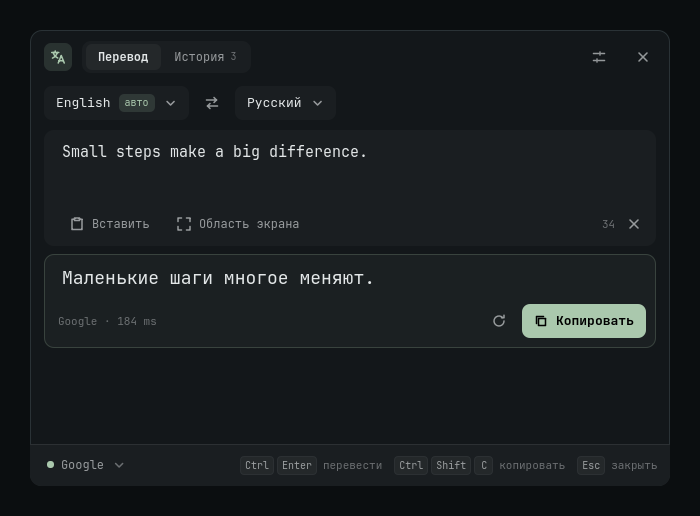
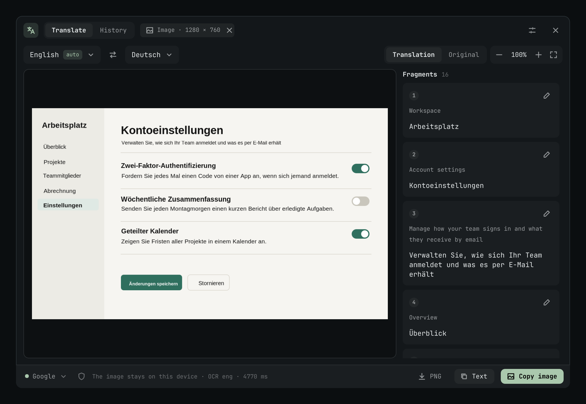

[English](README.md) · **Русский**

# OmaTranslate

Быстрый перевод выделенного текста, буфера обмена и скриншотов для **Omarchy 4 / Quickshell**. Backend написан на **Rust**, интерфейс — **QML** и следует теме рабочего стола.

## Возможности

- «Мой язык» в обе стороны: чужой текст переводится на твой язык, а текст на твоём — на язык, с которым ты работал последним (перевёл немецкий — следующий русский текст уйдёт на немецкий). Выбор языка и ⇄ в панели действуют только на текущий текст.
- 55 языков с офлайн-определением; Google без ключа, MyMemory, свой LibreTranslate и офлайн-движок (модели пока для английского ↔ русского).
- Четыре способа вызова; редактирование исходника и перевод при вводе.
- «Перевести и заменить»: выделенный текст заменяется переводом прямо в приложении, без окна (Super+Ctrl+U, через `wtype`).
- Названия не переводятся: CamelCase и токены с цифрами (GPT-6, FrontierCode), на картинках — «Имя 5.2»; свой список «Не переводить» в настройках.
- Локальное распознавание Tesseract (два прохода: разреженный текст интерфейсов и обычная вёрстка; инверсия тёмных тем, увеличение мелкого текста); онлайн-провайдер получает текст, а не изображение.
- Перевод прямо на изображении по ячейкам таблиц и абзацам, с кеглем и жирностью как у оригинала; масштабирование, оригинал/перевод, исправление OCR-блоков.
- Копирование текста/картинки и экспорт PNG через системный диалог.
- Загрузка и удаление языковых моделей; история текста только при включении в настройках.
- Интерфейс на 9 языках (следует языку Omarchy), тема Omarchy, горячие клавиши.

### Кнопка в баре

После установки справа в баре появляется значок перевода 文A. Разные кнопки мыши делают разное:

| Клик | Что происходит |
|---|---|
| 🖱️ Левый | Открывает панель переводчика |
| 🖱️ Правый | Открывает панель сразу на настройках |
| 🖱️ Средний (колесо) | Сразу переводит буфер обмена: текст показывается в панели, картинка распознаётся и переводится прямо на изображении |

Средний клик — самый быстрый способ перевести скопированное, не трогая клавиатуру. Эта же подсказка появляется при наведении на значок, на языке интерфейса. Кнопку можно переместить обычным способом Omarchy; повторная установка сохраняет её положение.



## Установка одной командой

Из каталога скачанного репозитория на Omarchy 4:

```bash
./install.sh
```

Скрипт сам устанавливает недостающие зависимости, собирает и устанавливает Arch-пакет, включает плагин и добавляет сочетания клавиш. Если пакет уже соответствует текущим исходникам и его SHA-256 совпадает, повторная сборка пропускается. Той же командой можно обновить приложение или завершить прерванную установку. Старый `./bin/install` остаётся совместимым входом.

Запускайте от своего пользователя, без `sudo`: пароль запрашивается только для установки системных пакетов. При запуске без интерактивного терминала скрипт откроет терминал Omarchy. Первая сборка требует интернета и может занять несколько минут. Rust, CMake и base-devel устанавливаются только при необходимости сборки; для работы нужны Cairo, Python 3, Tesseract с `eng` (установщик добавляет `tesseract-data-*` для языка системы, остальные можно поставить вручную), wl-clipboard, grim, slurp, Quickshell и xdg-desktop-portal.

Конфликтующие сочетания не перезаписываются. Резервные копии находятся в `~/.local/state/omatranslate/backups/`.

Идентификатор плагина — `vornashev.omatranslate`. Установщик сохраняет QML, добавляет кнопку в `shell.json`, затем ждёт подтверждения от оболочки. При обновлении с `tema.omatranslate` прежняя копия сохраняется в резервной папке, а её запись заменяется; настройки, история и модели продолжают использовать прежние каталоги. Уже запущенный backend этой Wayland-сессии перезапускается, чтобы он обращался к новому идентификатору.

При обновлении, если интерфейс плагина изменился, установщик перезапускает оболочку (`omarchy restart shell`, бар исчезает на пару секунд): загруженный плагин держит старые QML-типы в кэше, и обычной перезагрузки плагинов для этого недостаточно. Ошибки записи файлов или проверки сочетаний откатывают изменения интеграции. Временный сбой IPC оболочки не удаляет установленный плагин: установщик ждёт её загрузки, затем при необходимости один раз выполняет `omarchy restart shell` — бар на это время исчезнет. Если оболочка всё ещё недоступна, команда завершается с ошибкой и статусом `activation-pending` в диагностике, сохраняя файлы и запись кнопки для следующего запуска оболочки. Остальные виджеты не меняются; уже установленный системный пакет остаётся установленным.

Если пакет установлен, но кнопка не появилась, восстановите только интеграцию, без сборки и `sudo`:

```bash
./install.sh --plugin
```

Режим `--plugin` (старое имя `--repair` тоже работает) копирует QML из исходников и оставляет установленный backend; оболочка перезапускается, только если интерфейс изменился. Так же быстро обновляется плагин после правок в `plugin/`. Если менялся Rust-код, нужна обычная команда `./install.sh`.

Результат установки сохраняется в `~/.local/state/omatranslate/last-install.json`, а ошибки и ответы проверки Hyprland — в `last-integration.json` рядом. Подробная причина ошибки интеграции передаётся в исходный терминал. При запуске через отдельный терминал исходная команда возвращает результат установки, а не просто успешного открытия окна. Успех подтверждается сообщением `OmaTranslate installation completed successfully`, `OmaTranslate is installed` или `OmaTranslate plugin updated`; сообщение об открытии терминала само по себе этого не означает.

Дополнительные варианты:

```bash
./install.sh --offline-engine           # также установить движок офлайн-перевода
./install.sh --rebuild                  # принудительно пересобрать пакет
./install.sh --uninstall                # удалить приложение и интеграцию
```

Языковые модели скачиваются отдельно в настройках. Конфигурация и модели сохраняются при удалении.

## Установка через Marketplace

```bash
omarchy plugin add https://github.com/vornashev/OmaTranslate --enable
~/.config/omarchy/plugins/vornashev.omatranslate/install.sh
```

Первая команда добавляет QML-плагин из [каталога Omarchy](https://plugins.omarchy.org). Rust-backend Omarchy сам не собирает, это делает вторая команда. Пока она не выполнена, панель показывает эту команду с кнопкой копирования. Установщик сохраняет git-копию плагина, а сборку выполняет в `~/.cache/omatranslate/`, чтобы не вызывать перезагрузку оболочки на каждый файл компиляции.

| | Команда |
|---|---|
| Обновить | `omarchy plugin update vornashev.omatranslate`, затем снова `install.sh` |
| Удалить | `~/.config/omarchy/plugins/vornashev.omatranslate/install.sh --uninstall` |

## Разработка

Отдельные команды:

```bash
bin/package                            # только собрать пакет
bin/package --reuse                    # использовать актуальный проверенный пакет
python3 bin/integrate.py --dry-run      # проверить интеграцию и конфликты
omatranslate-integrate                  # включить плагин после установки пакета
omatranslate doctor                    # зависимости, языки OCR, модели
omatranslate settings
```

Для разработки можно добавить `target/debug` в PATH, собрать `cargo build`, затем запустить `python3 bin/integrate.py`. При установке из обычного каталога копируется QML; после изменений интерфейса нужно повторить интеграцию. При разработке прямо в каталоге Marketplace используется текущая git-копия. Интеграция перезапускает backend текущей Wayland-сессии.

## Офлайн

```bash
omatranslate-setup-offline
# Из исходников:
bin/setup-offline
```

Команда создаёт отдельное окружение в `$XDG_DATA_HOME/omatranslate/venv` и устанавливает CTranslate2 и SentencePiece. PyTorch и GPU не требуются. Затем откройте настройки и загрузите нужные модели EN→RU / RU→EN. Перезапустите backend после первоначальной установки движка, чтобы обновить индикатор его доступности.

Inference выполняется в отдельном постоянном Python-процессе; сеть, IPC, настройки, очередь, OCR и композиция изображения управляются Rust. Это позволяет использовать готовый runtime CTranslate2 без сборки C++-библиотеки внутри приложения. При отмене активного офлайн-задания процесс перезапускается, чтобы новая задача не ждала старую; обычные последовательные запросы используют уже загруженную модель.

Модели Argos 1.9 загружаются с официального `argos-net.com`. Без прогрева выгружаются после 10 минут простоя. Размер загрузки показывается, как только сервер сообщает Content-Length. Каталог Argos не публикует SHA-256: приложение фиксирует хеш архива и каждого распакованного файла при установке и проверяет целостность перед загрузкой модели. Это проверка последующей порчи, **не независимая проверка подлинности первого скачивания**. Для релизной фиксации архивов предусмотрен `bin/lock-models`; его результат устанавливается как `/usr/share/omatranslate/models.lock.json`.

## Сочетания

| Сочетание | Действие |
|---|---|
| Super+U | Выделенный текст (Wayland PRIMARY) |
| Super+Shift+U | Текст или изображение из буфера |
| Super+Alt+U | Выделить область экрана |
| Super+Ctrl+U | Перевести выделение и заменить его переводом |
| Ctrl+Enter | Перевести повторно |
| Ctrl+Shift+C | Копировать перевод |
| Esc | Закрыть настройки или панель |

PRIMARY зависит от приложения и содержит системное выделение, которое может сохраняться после изменения фокуса. Если выделение недоступно, используйте копирование и команду буфера; автоматического нажатия Ctrl+C нет. Буфер переводится только по явной команде и не отслеживается в фоне. В режиме буфера изображение имеет приоритет над текстовым MIME-представлением.

## Провайдеры

Google использует неофициальный веб-эндпоинт и может ограничивать запросы или менять формат. [MyMemory](https://mymemory.translated.net/doc/usagelimits.php) предоставляет 5 000 символов/день анонимно; ограничение 500 байт на сегмент учитывается при разбиении. [LibreTranslate](https://docs.libretranslate.com/) подключается по URL; HTTP допустим только для localhost, удалённые серверы должны использовать HTTPS.

Автоопределение работает офлайн для 55 языков (whatlang + правила для письменностей). Для коротких фраз приоритет у двух ваших языков: целевого и «второго». Если текст уже на целевом языке, он переводится на второй (по умолчанию английский; настраивается в разделе «Общие»). При первом запуске целевой язык и языки OCR берутся из системной локали. Локальные модели пока есть только для EN↔RU. Провайдер не меняется автоматически при ошибках.

## Данные и ограничения первой версии

- Конфигурация: `$XDG_CONFIG_HOME/omatranslate/settings.json`, режим 0600. Необязательный ключ LibreTranslate хранится в этом файле.
- Модели и опциональная история: `$XDG_DATA_HOME/omatranslate/`. История хранит до 100 текстовых записей; выключение удаляет её.
- Кэш перевода — только в памяти, до 512 сегментов. При закрытии панели временные изображения удаляются, оригинальные файлы не изменяются. Аварийное завершение процесса может оставить его временную папку в `/tmp`.
- Изображения до 32 Мп, до 250 распознанных блоков; основной сценарий — печатный текст на скриншотах. Восстановления фотофона и наложения на живое приложение нет.
- Если перевод не вмещается даже в свободное место рядом, на изображении остаётся оригинал, а полный перевод — в карточке фрагмента. Содержимое ответов отображается как обычный текст.
- Совместимость с Omarchy 3 и другими оболочками не заявляется.

## Проверка

```bash
bin/test --offline
cargo clippy --locked --offline --all-targets -- -D warnings
```

QML-проверка загружает настоящий интерфейс вне рабочего стола, проверяет автоперевод и вывод текста без HTML, сохраняет снимки в `/tmp/omatranslate-ui`. Визуальная регрессия (`tests/visual_regression.py`) рендерит все состояния в тёмной и светлой теме и сравнивает с эталонами `tests/visual/`; после намеренных изменений интерфейса: `python3 tests/visual_regression.py --update`. Сквозные тесты используют реальный Rust backend, реальный Tesseract и PNG-рендерер, но **тестовый процесс перевода**, поэтому не измеряют качество или скорость моделей. При запрете сокетов тесты явно переходят на диагностический stdio-транспорт.

Реальные API, скачивание моделей, inference и работа горячих клавиш в живой Wayland-сессии требуют отдельной проверки. Целевые задержки из проекта (панель p95 ≤150 мс, фраза офлайн ≤1 с) пока не считаются подтверждёнными бенчмарками.

Описание протокола и структуры: [docs/architecture.md](docs/architecture.md).

## Удаление

```bash
./install.sh --uninstall
```

Убираются плагин, кнопка в баре, сочетания клавиш и пакет. Настройки, история и модели сохраняются для повторной установки; удалить их можно отдельно из указанных выше каталогов. Без исходников доступны отдельные команды `omatranslate-integrate --remove` и `sudo pacman -R omatranslate`.
